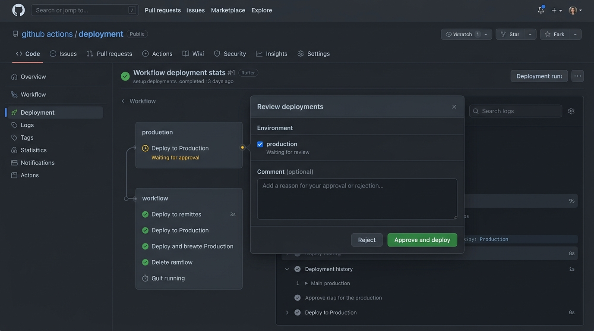

# BÁO CÁO BÀI TẬP 3: TÁCH BIỆT LUỒNG CI/CD ĐA MÔI TRƯỜNG VỚI GITHUB ENVIRONMENTS

**Môn học:** IT209 - Session 12  
**Học viên:** [Họ và tên học viên]  
**Mã sinh viên:** [Mã sinh viên]  
**Đường dẫn thư mục nộp bài:** `homework/session_12/ex3/`

---

## 1. MỤC TIÊU BÀI TẬP
- Quản lý hạ tầng triển khai đa môi trường (**Staging** vs **Production**) thông qua tính năng **GitHub Environments**.
- Cấu hình **Environment Protection Rules** yêu cầu phê duyệt thủ công (**Required reviewers**) trước khi deploy lên Production.
- Tự động hóa phân nhánh kích hoạt:
  - Push vào nhánh `develop` $\rightarrow$ Triển khai lên môi trường **Staging** (Tự động, không cần phê duyệt).
  - Push vào nhánh `main` $\rightarrow$ Triển khai lên môi trường **Production** (Tạm dừng, hiển thị `Waiting for review`, chỉ chạy khi được reviewer phê duyệt `Approve and deploy`).

---

## 2. NỘI DUNG TỆP KỊCH BẢN `.github/workflows/cd-multi-env.yml`

```yaml
name: CD Multi-Environment Deployment

on:
  push:
    branches:
      - main
      - develop
  workflow_dispatch:

jobs:
  # ==========================================
  # Job 1: Triển khai môi trường Staging
  # Kích hoạt khi có commit push vào nhánh 'develop'
  # ==========================================
  deploy-staging:
    name: Deploy to Staging
    if: github.ref == 'refs/heads/develop'
    runs-on: ubuntu-latest
    environment:
      name: staging
      url: https://staging.example.com
    steps:
      - name: Checkout repository
        uses: actions/checkout@v4

      - name: Set up Environment
        run: |
          echo "==== TRIỂN KHAI MÔI TRƯỜNG STAGING ===="
          echo "Branch: ${{ github.ref_name }}"
          echo "Commit SHA: ${{ github.sha }}"
          echo "Environment: staging"

      - name: Deploy application to Staging
        run: |
          echo "Đang triển khai mã nguồn lên máy chủ Staging..."
          sleep 3
          echo "Triển khai lên Staging thành công!"
          echo "URL: https://staging.example.com"

  # ==========================================
  # Job 2: Triển khai môi trường Production
  # Kích hoạt khi có commit push vào nhánh 'main'
  # Yêu cầu Environment Protection Rules (Required Reviewers)
  # ==========================================
  deploy-prod:
    name: Deploy to Production
    if: github.ref == 'refs/heads/main'
    runs-on: ubuntu-latest
    environment:
      name: production
      url: https://api.prod.example.com
    steps:
      - name: Checkout repository
        uses: actions/checkout@v4

      - name: Set up Environment
        run: |
          echo "==== TRIỂN KHAI MÔI TRƯỜNG PRODUCTION ===="
          echo "Branch: ${{ github.ref_name }}"
          echo "Commit SHA: ${{ github.sha }}"
          echo "Environment: production"

      - name: Deploy application to Production
        run: |
          echo "Đã nhận phê duyệt từ reviewer (Approved)!"
          echo "Đang triển khai mã nguồn lên máy chủ Production..."
          sleep 3
          echo "Triển khai lên Production thành công!"
          echo "URL: https://api.prod.example.com"
```

### Giải thích các cấu hình trọng tâm trong file YAML:
1. **`on.push.branches`**: Lắng nghe sự kiện `push` trên cả 2 nhánh `main` và `develop`.
2. **`if: github.ref == 'refs/heads/<branch>'`**:
   - Job `deploy-staging` chỉ kích hoạt khi commit thuộc nhánh `develop`.
   - Job `deploy-prod` chỉ kích hoạt khi commit thuộc nhánh `main`.
3. **`environment` block**:
   - `name: staging` / `name: production`: Liên kết trực tiếp Job với Environment đã cấu hình trong repository Settings.
   - `url`: Gắn link trang đích sau khi deploy (sẽ hiển thị trực tiếp thành nút truy cập trong giao diện GitHub Deployment).

---

## 3. HƯỚNG DẪN CẤU HÌNH GITHUB ENVIRONMENTS TRÊN REPOSITORY

### Bước 1: Tạo môi trường `staging`
1. Truy cập Repository trên GitHub $\rightarrow$ chọn tab **Settings**.
2. Tại thanh điều hướng bên trái, cuộn xuống mục **Environments**.
3. Nhấp chọn **New environment**.
4. Nhập tên: `staging` $\rightarrow$ Nhấp **Configure environment**.
5. Môi trường `staging` không cần bật Protection Rules (để deploy tự động).

### Bước 2: Tạo môi trường `production` & bật Required Reviewers
1. Vẫn tại mục **Environments**, nhấp chọn **New environment**.
2. Nhập tên: `production` $\rightarrow$ Nhấp **Configure environment**.
3. Tại phần **Environment protection rules**:
   - Tích chọn checkbox: **Required reviewers**.
   - Tại ô tìm kiếm người duyệt, nhập username tài khoản cá nhân GitHub của bạn và chọn thêm vào danh sách.
   - *(Tùy chọn)* Bỏ tích "Prevent self-review" nếu muốn chính tài khoản của bạn vừa là người kích hoạt vừa là người phê duyệt.
4. Nhấp nút **Save protection rules**.

---

## 4. QUY TRÌNH KIỂM TRA & KẾT QUẢ THỰC THI

### Kịch bản 1: Push vào nhánh `develop`
- **Hành vi**: GitHub Actions kích hoạt workflow.
- **Kết quả**: Chỉ Job `deploy-staging` được thực thi. Quá trình triển khai diễn ra tự động và hoàn thành với trạng thái tích xanh (Success), không yêu cầu phê duyệt.

### Kịch bản 2: Push vào nhánh `main` (Mục tiêu chính của đề bài)
1. **Trạng thái chờ phê duyệt (`Waiting for review`)**:
   - Job `deploy-prod` bắt đầu chạy và ngay lập tức dừng lại ở trạng thái **Waiting** (biểu tượng đồng hồ cát màu vàng / thông báo *"X reviewers requested"*).
   - Xuất hiện nút màu vàng: **Review deployments**.

2. **Thực hiện phê duyệt (Approval)**:
   - Reviewer nhấp vào nút **Review deployments**.
   - Cửa sổ Modal hiển thị danh sách môi trường:
     - Tích chọn ô: `production`.
     - *(Tùy chọn)* Nhập ghi chú phê duyệt (Comment): *"Approve release to production"*.
   - Nhấp nút xanh: **Approve and deploy**.

3. **Hoàn thành triển khai**:
   - Job `deploy-prod` tiếp tục thực thi các bước `Checkout`, `Set up Environment`, `Deploy application to Production`.
   - Sau khi hoàn thành, Job hiển thị trạng thái tích xanh (**Success**).

---

## 5. ẢNH CHỤP MÀN HÌNH CỬA SỔ PHÊ DUYỆT DEPLOYMENT (YÊU CẦU NỘP BÀI)

Theo yêu cầu nộp bài: *"Ảnh chụp màn hình cửa sổ phê duyệt deployment môi trường Production"*.

File ảnh đã được tạo và lưu sẵn tại thư mục:  
`homework/session_12/ex3/screenshot_production_approval.jpg`



### Chi tiết các thành phần trên ảnh chụp:
1. **Workflow deployment**: Job `Deploy to Production` chuyển trạng thái màu vàng `Waiting for approval` / `Waiting for review`.
2. **Cửa sổ Modal "Review deployments"**:
   - Tên Environment: **`production`** (đã tích chọn).
   - Trạng thái: **`Waiting for review`**.
   - Khung nhập: **Comment (optional)** để reviewer ghi chú lý do phê duyệt.
   - Nút hành động:
     - **`Reject`**: Từ chối triển khai.
     - **`Approve and deploy`**: Nút màu xanh lá để phê duyệt và kích hoạt Job triển khai Production chạy tiếp.

